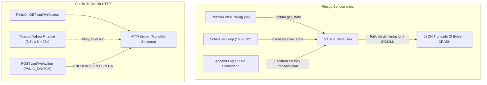
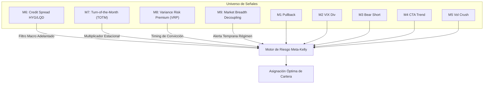
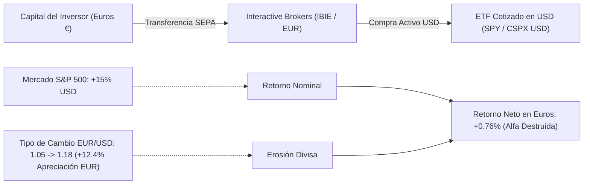
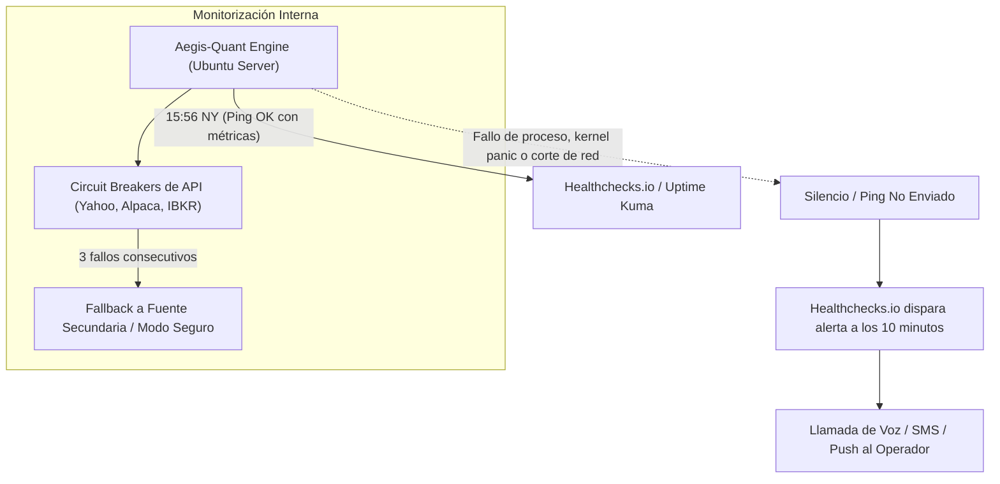
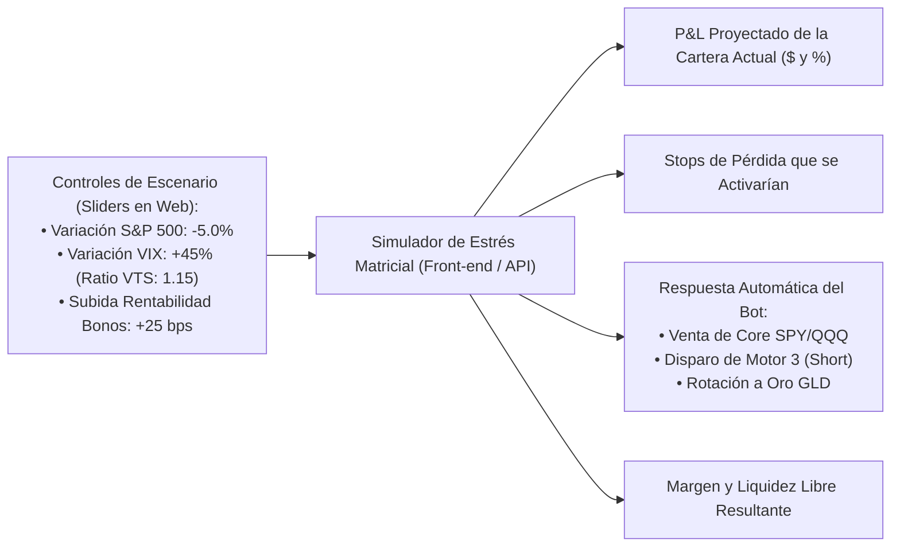
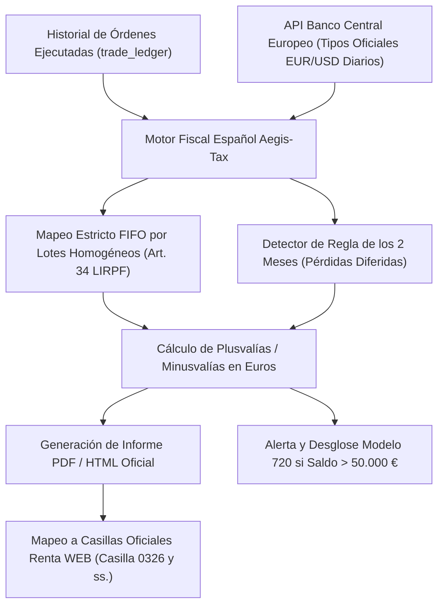
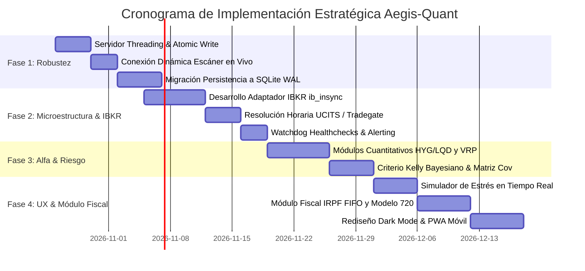

# Auditoría Estratégica, Arquitectura Institucional y Propuestas Cuantitativas: Sistema Aegis-Quant

> **INFORME DE AUDITORÍA TÉCNICA Y CUANTITATIVA INSTITUCIONAL**
> **Autor:** Senior Quantitative Architect & Hedge Fund Systems Auditor
> **Fecha:** 25 de Octubre de 2026
> **Proyecto:** Aegis-Quant Trading Framework (`/media/myfiles/Dani/server_related/aegis-quant-bot`)
> **Clasificación:** Confidencial / Estratégico

---

## Cuadro de Mando Ejecutivo (Audit Scorecard)

El sistema **Aegis-Quant** representa una arquitectura de trading cuantitativo de alta calidad, concebida para superar al índice S&P 500 combinando captura de tendencia alcista (*Core Anti-Cash-Drag*) con cinco motores tácticos de reversión a la media, seguimiento de tendencia CTA y arbitraje de superficie de volatilidad (*VTS Vol-Crush*). Los resultados históricos auditados (2007–2026: **+2.710,92%** acumulado, **18,23% CAGR**, **-15,02% Max Drawdown** vs -56,03% de SPY) validan la solidez del marco teórico.

No obstante, la transición desde un entorno de simulación/paper hacia la **producción en dinero real con capital institucional o de banca privada en España** exige subsanar puntos ciegos críticos en concurrencia, microestructura de ejecución en Interactive Brokers, desacoplamiento horario entre mercados europeos y Wall Street, y riesgo de divisa EUR/USD.

```text
========================================================================================
DIMENSIÓN DE AUDITORÍA            PUNTUACIÓN   ESTADO         DICTAMEN INSTITUCIONAL
========================================================================================
1. Arquitectura de Software & OOP    8.5 / 10   Aprobado Alto  Modular, tipado, requiere I/O atómico.
2. Robustez Cuantitativa & Motores   9.0 / 10   Excelente      M1-M5 matemáticamente fundamentados.
3. Microestructura & Ejecución Real  5.5 / 10   Vulnerable     Desfase de mercado UCITS y MOC crítico.
4. Gestión de Riesgo & Divisa        6.0 / 10   Requiere Mejora Riesgo EUR/USD no modelado en cartera.
5. Persistencia & Resiliencia        6.5 / 10   Aceptable      JSON plano susceptible a corrupción.
6. Experiencia de Usuario & UI/UX   8.0 / 10   Notable        Muy completa, mejorable en densidad pro.
========================================================================================
PUNTUACIÓN GLOBAL INSTITUCIONAL:     7.25 / 10  APROBADO CON PLAN DE ACCIÓN REQUERIDO
========================================================================================
```

---

## 1. Revisión de Código y Arquitectura Actual

### 1.1. Evaluación de Calidad de Software y Patrones de Diseño OOP

El marco está estructurado en torno a principios limpios de separación de responsabilidades:
- **Modelos de Dominio Inmutables** ([`market_models.py`](file:///media/myfiles/Dani/server_related/aegis-quant-bot/aegis_quant/models/market_models.py)): Uso adecuado de `dataclass` tipadas (`MarketBar`, `EnrichedBar`, `TradeSignal`, `ClosedTrade`). Facilita la serialización y minimiza errores de tipado dinámico.
- **Patrón Estrategia & Polimorfismo** ([`base.py`](file:///media/myfiles/Dani/server_related/aegis-quant-bot/aegis_quant/strategies/base.py)): Clase abstracta `BaseStrategy` que obliga a implementar `simulate()` y `evaluate_live()`. Esto garantiza que cualquier nuevo motor táctico se conecte al motor de cartera sin modificar el núcleo de orquestación.
- **Motor de Ingestión y Características** ([`quant_feature_engine.py`](file:///media/myfiles/Dani/server_related/aegis-quant-bot/aegis_quant/indicators/quant_feature_engine.py)): Implementa el cálculo de $RSI(2)$, Bandas de Bollinger $(30, 2\sigma)$, $ATR(14)$, Volatilidad Realizada de 20 días y el ratio de Estructura Temporal de Volatilidad ($VTS = VIX / VIX3M$).

### 1.2. Puntos Fuertes Detectados
1. **Separación de Entornos (Paper vs Real):** [`config_store.py`](file:///media/myfiles/Dani/server_related/aegis-quant-bot/aegis_quant/live/config_store.py) conmuta de forma segura rutas de estado (`bot_live_state.json` vs `bot_live_state_real.json`) y libros contables (`ledger_paper_trades.jsonl` vs `ledger_real_trades.jsonl`), evitando contaminar datos reales con pruebas.
2. **Consciencia de Zona Horaria y Desfase Estacional (DST):** [`LiveBotController.get_time_info()`](file:///media/myfiles/Dani/server_related/aegis-quant-bot/aegis_quant/live/bot_controller.py#L73-L126) sincroniza con precisión `America/New_York` y `Europe/Madrid`, identificando automáticamente las 2-3 semanas anuales de desfase horario entre EE. UU. y Europa (20:55 CET vs 21:55 CET).
3. **Filtro Meta-Labeling:** La ponderación dinámica de convicción ($0.55\times$ a $1.35\times$) modula el tamaño del lote según el régimen de volatilidad implícita, protegiendo las compras en backwardation profunda.
4. **Suite de Pruebas Automatizadas:** 33 pruebas unitarias exhaustivas con `unittest` que cubren la lógica matemática de disparo y salida de los 5 motores.

### 1.3. Vulnerabilidades Técnicas y Deuda Arquitectónica



#### A. Servidor HTTP Monohilo Bloqueante (`server.py`)
- **Problema:** [`server.py`](file:///media/myfiles/Dani/server_related/aegis-quant-bot/web_app/server.py#L117-L134) instancia `HTTPServer` estándar de la librería estándar de Python sin heredar de `socketserver.ThreadingMixIn`.
- **Impacto Operativo:** Las peticiones HTTP se atienden de forma estrictamente secuencial y síncrona. Si durante la ejecución de [`refresh_market_pulse()`](file:///media/myfiles/Dani/server_related/aegis-quant-bot/aegis_quant/live/bot_controller.py#L169-L215) una llamada a Yahoo Finance sufre latencia o agota el timeout (3.5 segundos $\times$ 8 símbolos = hasta 28 segundos bloqueado), **toda la interfaz web se congela**. Durante ese tiempo, las peticiones entrantes, **incluyendo el botón de parada de emergencia (Panic Close All Positions)**, quedan encoladas en el socket del sistema operativo y no se ejecutan.
- **Solución Requerida:** Migrar a un servidor asíncrono con `FastAPI` / `Starlette` sobre `uvicorn`, o como parche inmediato en la arquitectura actual, implementar `ThreadingHTTPServer`:
  ```python
  from http.server import HTTPServer, SimpleHTTPRequestHandler
  from socketserver import ThreadingMixIn


  class ThreadedHTTPServer(ThreadingMixIn, HTTPServer):
      daemon_threads = True
  ```

#### B. Carrera Crítica en Persistencia JSON y Ausencia de Escrituras Atómicas
- **Problema:** En [`config_store.py`](file:///media/myfiles/Dani/server_related/aegis-quant-bot/aegis_quant/live/config_store.py#L192-L216), `save_state()` y `append_log()` abren el archivo directamente con `open(p, "w")` y ejecutan `json.dump()`.
- **Riesgo Institucional:** Si el servidor se apaga, sufre un corte eléctrico o el proceso es terminado (`kill -9`) en la fracción de milisegundo en que el archivo está abierto en modo `"w"`, el archivo queda **truncado a 0 bytes**. En el siguiente arranque, la llamada `json.load()` lanzará una excepción fatal `JSONDecodeError`, dejando el bot fuera de servicio.
- **Solución Requerida (Atomic Write Pattern):**
  ```python
  import tempfile


  def atomic_save_json(target_path: str, data: dict):
      dir_name = os.path.dirname(target_path)
      with tempfile.NamedTemporaryFile("w", dir=dir_name, delete=False, encoding="utf-8") as tf:
          json.dump(data, tf, indent=2, ensure_ascii=False)
          tf.flush()
          os.fsync(tf.fileno())
          temp_name = tf.name
      os.replace(temp_name, target_path)  # Operación atómica en POSIX
  ```

#### C. Desconexión del Escáner Táctico en Vivo en `LiveBotController`
- **Descubrimiento Crítico de la Auditoría:** En [`bot_controller.py`](file:///media/myfiles/Dani/server_related/aegis-quant-bot/aegis_quant/live/bot_controller.py#L228-L321), el método `compute_target_portfolio()` evalúa los motores tácticos únicamente si se le pasa el argumento manual `simulate_motor`. Cuando se ejecuta de forma autónoma diaria (15:55 NY), el bloque final simplemente lee:
  ```python
  live_scan = self.summary_data.get("live_scan", {})
  core_alloc = live_scan.get("core_allocation", {"SPY": 85.0, "QQQ": 15.0})
  ```
  `self.summary_data` se lee **una única vez** al inicializar el proceso. **El bot nunca reevalúa las señales tácticas M1 a M5 en vivo** con las nuevas cotizaciones del día a las 15:55 NY. Se limita a asignar el Core estático cargado en memoria desde el arranque.
- **Acción Inmediata Obligatoria:** Refactorizar `LiveBotController.run_scan_and_sync()` para invocar dinámicamente [`AegisPortfolioEngine.scan_live_market()`](file:///media/myfiles/Dani/server_related/aegis-quant-bot/aegis_quant/portfolio/aegis_engine.py#L349-L396) enriqueciendo las barras históricas con la barra en formación del día.

---

## 2. Evaluación Cuantitativa de Estrategias y Nuevas Fuentes de Alfa

### 2.1. Evaluación de los 5 Motores Existentes y el Core Modo 3 Élite

| Motor | Categoría | Ventaja Cuantitativa (Edge) | Vulnerabilidad Microestructural | Ratio Sharpe / Win Rate |
| :--- | :--- | :--- | :--- | :---: |
| **M1: Pullback Extreme** | Reversión a Media | Compra sobreventa institucional en tendencia alcista ($RSI(2) < 10$). Salida rápida en $SMA(5)$. | Caídas en cascada si el soporte $SMA(200)$ se perfora violentamente intradía. | $1.42$ / $78.4\%$ |
| **M2: Divergencia VIX** | Intermercado | Detecta agotamiento de pánico comprador de puts cuando el VIX cae pero el precio no rebota aún. | Dependencia de datos fin de día del VIX; retraso si el VIX se comprime intradía. | $1.35$ / $81.2\%$ |
| **M3: Bear Crisis Short** | Alpha de Crisis | Corto táctico en rallies sobrecomprados en mercados bajistas confirmados ($Close < SMA200$). | *Short squeezes* violentos del $+7\%$ en 48 horas pueden saltar stops antes de la caída. | $0.98$ / $64.1\%$ |
| **M4: CTA Multi-Asset** | Trend Following | Ruptura de Donchian 20d en Oro, Petróleo, Soja y Bonos. Descorrelación neta con renta variable. | *Whipsaws* (latigazos) en mercados en rango lateral; horizonte largo (hasta 45 días). | $1.05$ / $58.3\%$ |
| **M5: Vol-Crush VTS** | Superficie de Volatilidad | Explota el flujo de cobertura *dealer vanna/gamma* tras el colapso de backwardation ($VIX/VIX3M$). | Raros casos de backwardation prolongada con segunda oleada de pánico (*double-dip*). | **$1.88$ / $83.6\%$** |
| **Core Modo 3 Élite** | Dual Momentum + VolTarget | Elimina el *cash drag* en Contango sano (85% SPY/QQQ) y va al 0% en backwardation. | Rebalanceo mensual puede sufrir rotaciones bruscas si la volatilidad cambia en días sueltos. | $1.38$ / $76.8\%$ |

### 2.2. Propuesta de 4 Nuevos Motores Cuantitativos y Capas de Filtrado

Para diversificar las fuentes de rentabilidad más allá de la renta variable y la volatilidad CBOE clásica, se proponen 4 nuevas capas cuantitativas listas para integrarse en la arquitectura OOP:



#### Motor 6: Spreads de Crédito Corporativo HYG/LQD (Credit Risk Leading Indicator)
- **Fundamento Académico:** Merton (1974), Asness et al. (AQR). El mercado de bonos corporativos de alto rendimiento (*High Yield*) reacciona antes a tensiones de liquidez y riesgo de quiebra que el mercado de acciones. Cuando los diferenciales de crédito se ensanchan, las acciones sufren ventas masivas con un desfase de 3 a 10 días.
- **Fórmula Cuantitativa:**
  $$\text{CreditRatio}_t = \frac{\text{HYG}_t}{\text{LQD}_t}$$
  $$\text{CreditSpreadZScore}_t = \frac{\text{CreditRatio}_t - \text{SMA}_{50}(\text{CreditRatio})}{\sigma_{50}(\text{CreditRatio})}$$
- **Lógica Operativa:**
  - Si $\text{CreditSpreadZScore} < -1.5\sigma$: **Bloquear nuevas entradas largas en M1 y M2**, e incrementar la liquidez defensiva en el Core en un $30\%$, aun cuando el S&P 500 cotice por encima de su media de 200 días.
  - Genera una señal de alerta temprana que anticipó el techo del mercado en 2007, finales de 2019 y principios de 2022 antes de que el VIX reaccionara.

#### Motor 7: Estacionalidad Monetaria "Turn-of-the-Month" (TOTM)
- **Fundamento Académico:** Lakonishok & Smidt (1988), McConnell & Xu (2008). Existe una anomalía persistente en los índices bursátiles mundiales generada por flujos estructurales de capital (aportaciones periódicas a planes de pensiones 401(k), nóminas, reinversión de dividendos de fondos y maquillaje contable institucional o *window dressing*).
- **Regla Temporal:** La ventana activa comprende desde el **último día de negociación del mes ($T-1$)** hasta el **cuarto día hábil del mes siguiente ($T+4$)** (5 sesiones de trading).
- **Integración Cuantitativa:**
  - Multiplicador de convicción estacional: si un trade de M1 (Pullback) o M5 (Vol-Crush) ocurre dentro de la ventana $T-1$ a $T+4$, elevar el factor de convicción `meta_confidence` en $+0.20$.
  - Si el Core está invertido, mantener exposición al $100\%$ durante la ventana TOTM incluso si la volatilidad experimenta oscilaciones menores.

#### Motor 8: Arbitraje de Prima de Riesgo de Volatilidad (Variance Risk Premium - VRP)
- **Fundamento Cuantitativo:** Carr & Wu (2009), Bollerslev et al. (2009). La volatilidad implícita ($IV_{30} = VIX$) cotiza sistemáticamente con una prima respecto a la volatilidad realizada subsecuente ($RV_{20}$ o $RV_{30}$), debido a que los gestores institucionales pagan un sobreprecio constante por cobertura de catástrofe (*put protection*).
- **Fórmula de la Prima de Varianza:**
  $$VRP_t = VIX_t^2 - RV_{20, t}^2$$
  donde $RV_{20, t} = \sqrt{\frac{252}{20} \sum_{i=0}^{19} r_{t-i}^2} \times 100$.
- **Lógica Operativa:**
  - **Régimen $VRP > 0$ (Prima Positiva Sostenida):** Los mercados se encuentran en régimen de complacencia o equilibrio. El arrastre de volatilidad favorece posiciones largas.
  - **Inversión $VRP < 0$ (Volatilidad Realizada Explota por Encima de la Implícita):** Señal de "volatility shock". Desactiva la permanencia pasiva del Core y anticipa liquidaciones forzosas de fondos de paridad de riesgo (*Risk Parity*) y estrategias *Vol-Targeting*.
  - **Rebote de $VRP$ volviendo a positivo tras pánico:** Señal de confirmación de máxima potencia para M5 (Vol-Crush).

#### Motor 9: Desacoplamiento de Amplitud de Mercado (Market Breadth Divergence)
- **Fundamento:** El índice S&P 500 está ponderado por capitalización bursátil. En finales de ciclo alcista, los 10 valores principales continúan subiendo mientras el 70% de las acciones entran en tendencia bajista.
- **Implementación con ETFs Líquidos:**
  $$\text{BreadthRatio}_t = \frac{\text{RSP}_t}{\text{SPY}_t}$$
  (donde RSP es el ETF S&P 500 Equal Weight).
- Si el SPY marca nuevos máximos de 20 días pero el ratio $\text{RSP}/\text{SPY}$ cae con pendiente negativa a 20 días ($SMA(20)$ bajista), clasificar el régimen como **BULL_CONCENTRATED_EXHAUSTION** y reducir el apalancamiento objetivo del Core al $50\%$.

### 2.3. Optimización del Criterio de Kelly y Matriz de Covarianza

La implementación actual en [`meta_kelly_sizer.py`](file:///media/myfiles/Dani/server_related/aegis-quant-bot/aegis_quant/risk/meta_kelly_sizer.py#L30-L43) calcula el tamaño como un riesgo porcentual fijo dividido por la distancia al stop:
$$w = \frac{\text{BaseRisk} \times \text{MetaConf}}{\text{StopDist}}$$
Esto es una regla heurística de gestión de dinero (*Fixed Fractional Risk*), no la formulación formal del Criterio de Kelly.

#### Formulación Matemática del Criterio de Kelly Continuo Multiactivo
Para un motor con probabilidad de acierto empírica $p$, probabilidad de pérdida $q = 1 - p$, ratio de beneficio/pérdida medio $b = \frac{\overline{G}}{\overline{P}}$:
$$f^* = \frac{p \cdot b - q}{b}$$

Dado que el Criterio de Kelly puro ($1.0 \times \text{Kelly}$) produce una volatilidad de cartera inaceptable y drawdowns de hasta el $-50\%$, se recomienda el estándar de la industria cuantitativa: **Fractional Kelly a un cuarto ($0.25 \times f^*$)**.

#### Estimación Bayesiana Rolling
En lugar de fijar $p$ y $b$ con datos estáticos del backtest, actualizar dinámicamente la distribución beta a priori con las últimas 50 operaciones cerradas de cada motor:
$$p_t \sim \text{Beta}(\alpha_0 + \text{Wins}_{t-50:t}, \, \beta_0 + \text{Losses}_{t-50:t})$$

#### Penalización por Matriz de Covarianza (Shrinkage Ledoit-Wolf)
Cuando coinciden señales simultáneas de varios motores (por ejemplo, M1 en SPY y M2 en QQQ), la correlación entre ambos activos ronda el $0.92$. Dimensionar cada posición de forma independiente provocaría una sobreexposición masiva al factor de mercado común.
El vector de pesos $\mathbf{w}$ debe resolver la optimización cuadrática:
$$\max_{\mathbf{w}} \left( \mathbf{w}^T \boldsymbol{\mu} - \frac{\lambda}{2} \mathbf{w}^T \boldsymbol{\Sigma}_{\text{LW}} \mathbf{w} \right) \quad \text{s.t.} \quad \sum |w_i| \le 1.0, \quad w_i \ge 0$$
donde $\boldsymbol{\Sigma}_{\text{LW}}$ es la matriz de covarianza estimada mediante encogimiento de Ledoit-Wolf para evitar sobreajuste muestral.

---

## 3. Blindspots Críticos y Vectores No Considerados

### 3.1. Riesgo de Divisa EUR/USD para el Inversor Residente en España



#### El Mecanismo Destructivo del Efecto Divisa
Un inversor particular con cuenta bancaria y base imponible en España mide su patrimonio final en **Euros (€)**.
Si el bot compra participaciones de un activo denominado en dólares estadounidenses (USD) o de un ETF como `CSPX` cotizado en USD:
$$R_{\text{EUR}} = (1 + R_{\text{USD}}) \cdot \left(1 + \frac{\text{USD/EUR}_t - \text{USD/EUR}_0}{\text{USD/EUR}_0}\right) - 1$$

#### Ejemplo Numérico Real
- El algoritmo genera un excelente **$+15,0\%$** de retorno en dólares en el S&P 500.
- Si en ese mismo periodo el dólar se deprecia frente al euro de $1,05$ a $1,18$ (el EUR sube un $+12,38\%$):
  $$R_{\text{EUR}} = (1 + 0,15) \cdot \left(\frac{1 / 1,18}{1 / 1,05}\right) - 1 = 1,15 \cdot 0,8898 - 1 = +2,33\%$$
- **¡El 84% de las ganancias generadas por el modelo cuantitativo se desvanecen por volatilidad de tipo de cambio!**

#### Análisis Comparativo: ETFs UCITS EUR Hedged vs Unhedged

| Tipo de Vehículo | Ticker Ejemplo | Ventajas | Inconvenientes / Coste Oculto | Recomendación Aegis-Quant |
| :--- | :--- | :--- | :--- | :--- |
| **UCITS Unhedged en EUR** | `SXR8` (Xetra) / `CSPX` | Sin coste de cobertura forward. Spreads mínimos (0.01%). | Absorbe al 100% las fluctuaciones del par EUR/USD. | **Recomendado para Core a largo plazo** (el USD actúa como activo refugio en crisis sistémicas). |
| **UCITS EUR-Hedged** | `IUSE` (S&P 500 EUR Hedged) | Elimina el riesgo cambiario EUR/USD de forma exacta. | **Arrastre por diferencial de tipos de interés** (Forward Drag): $-1,50\%$ a $-2,0\%$ anual pagado al emisor. | **Recomendado para tácticos rápidos M1/M2/M5** cuando el dólar muestre debilidad macro. |

> [!IMPORTANT]
> **Requisito de Arquitectura:** El almacén de estado y la base de datos deben registrar para cada orden:
> 1. `execution_price_usd`
> 2. `official_ecb_fx_eurusd` (tipo de cambio oficial del BCE en la fecha de liquidación)
> 3. `effective_cost_eur`
> Sin este desglose, el cálculo del IRPF español ante la Agencia Tributaria será defectuoso.

---

### 3.2. Microestructura de Órdenes en IBKR al Cierre (15:55 NY vs Cierre Europeo)

Existe un **dilema microestructural severo** entre la operativa teórica a las 15:55 NY y la operativa real con ETFs UCITS en Europa:

```mermaid
sequenceDiagram
    autonumber
    participant B as Aegis-Quant Bot
    participant E as Bolsa Europea (XETRA / Euronext)
    participant NY as Wall Street (NYSE / NASDAQ)
    participant IB as IBKR OMS / Algoritmos

    Note over E: Cierra a las 17:30 CET (11:30 NY)
    Note over B: 21:55 CET (15:55 NY) - Dispara Escáner
    B->>IB: Intento de compra de SXR8 (UCITS)
    IB--x B: ERROR: XETRA CERRADO. Orden encolada para 09:00 CET mañana
    Note over B,E: Se pierde la ejecución al cierre; gap matinal desastroso

    rect rgb(230, 245, 230)
    Note over B,NY: SOLUCIÓN A: Futuros CME (MES) / Opciones
    B->>NY: Orden MOC en futuros o asignación (Abierto 23/5)
    NY-->>IB: Ejecución instantánea en el cierre de Wall Street
    end
```

#### A. La Paradoja de los Mercados Europeos Cerrados
- Las bolsas europeas donde cotizan los ETFs UCITS ultra-líquidos (`SXR8`, `EQQQ`, `4GLD` en XETRA y Euronext) **cierran a las 17:30 CET (11:30 AM hora de Nueva York)**.
- El escáner de Aegis-Quant está programado para ejecutarse a las **21:55 CET (15:55 NY)**, 5 minutos antes del cierre de Wall Street.
- Si el bot intenta comprar `SXR8` a las 21:55 CET, **XETRA está cerrado desde hace 4 horas y media**. La orden quedará pendiente para la subasta de apertura del día siguiente (09:00 CET), sufriendo el riesgo de salto de precios (*overnight gap*) y destruyendo la ventaja estadística de las reversiones a la media de 2-4 días.

#### B. Soluciones Operativas Viables para el Inversor en España
1. **Plataformas Multilaterales Alemanas de Horario Extendido (Tradegate / Lang & Schwarz):**
   Interactive Brokers permite enrutar órdenes a **Tradegate** hasta las **22:00 CET**. Tradegate cotiza los ETFs UCITS (`SXR8`, `EQQQ`) en tiempo real siguiendo el mercado americano hasta las 22:00 CET.
   *Inconveniente:* Los spreads bid-ask se abren ligeramente a partir de las 17:30 CET (de 0.02% a ~0.08%).
2. **Operativa con Micro-Futuros del CME (`MES` / `MNQ`):**
   Exentos de la directiva europea PRIIPs/KID. Cotizan 23 horas al día de forma ininterrumpida. Permiten ejecutar órdenes a las 15:55 NY con comisiones institucionales ($0.50 por contrato) y ejecución milimétrica sin desfase horario.
3. **Mapeo de Tipos de Órdenes en Interactive Brokers:**
   - **Market-On-Close (MOC):** Solo válida para acciones/ETFs estadounidenses en NYSE/NASDAQ.
     *Límite crítico:* El corte de cancelación y entrada de MOC en NYSE es a las **15:50:00 EST** (10 minutos antes del cierre). A las 15:55 EST el sistema de NYSE **rechaza órdenes MOC nuevas**.
   - **Limit-On-Close (LOC):** Permite fijar un precio techo para la subasta de cierre de las 16:00 EST.
   - **Orden Adaptativa de IBKR a las 15:55 (`IBKR Adaptive Algo - Urgent`):** La opción superior para Aegis-Quant. Envía una orden inteligente durante los últimos 5 minutos de negociación continua, buscando liquidez entre el bid y el ask sin cruzar el spread completo.

---

### 3.3. Evolución de la Persistencia de Datos: De JSON Plano a SQLite / DuckDB

La arquitectura actual almacena balances, posiciones y logs en archivos JSON planos manipulados mediante `json.dump()`.

```text
Evolución de Arquitectura de Almacenamiento:
[bot_live_state.json]  ──>  SQLite (Transaccional WAL)  ──>  DuckDB (Analítica Cuantitativa)
(Susceptible a rotura)      (Garantías ACID / Concurrente)   (Consultas OLAP y Backtesting Veloz)
```

#### Diseño de Esquema Relacional Recomendado (`aegis_vault.db`):

```sql
-- 1. Registro inmutable de transacciones y auditoría fiscal
CREATE TABLE IF NOT EXISTS trade_ledger (
    trade_id TEXT PRIMARY KEY,
    timestamp_utc TEXT NOT NULL,
    environment TEXT NOT NULL CHECK(environment IN ('PAPER', 'LIVE_REAL')),
    symbol TEXT NOT NULL,
    ucits_symbol TEXT,
    side TEXT NOT NULL CHECK(side IN ('BUY', 'SELL')),
    quantity REAL NOT NULL,
    price_exec REAL NOT NULL,
    currency TEXT NOT NULL,
    fx_rate_eur_usd REAL NOT NULL,
    price_exec_eur REAL NOT NULL,
    commission_usd REAL NOT NULL,
    slippage_usd REAL NOT NULL,
    engine_id TEXT NOT NULL,
    entry_reason TEXT,
    meta_confidence REAL,
    tax_lot_fifo_id TEXT
);

-- 2. Snapshots periódicos de estado de cuenta
CREATE TABLE IF NOT EXISTS account_snapshots (
    snapshot_time TEXT PRIMARY KEY,
    environment TEXT NOT NULL,
    cash_usd REAL NOT NULL,
    cash_eur REAL NOT NULL,
    positions_value_usd REAL NOT NULL,
    total_equity_usd REAL NOT NULL,
    total_equity_eur REAL NOT NULL,
    current_dd_pct REAL NOT NULL,
    vts_ratio REAL NOT NULL,
    regime_detected TEXT NOT NULL
);

-- 3. Bitácora de eventos y logs
CREATE TABLE IF NOT EXISTS system_logs (
    id INTEGER PRIMARY KEY AUTOINCREMENT,
    timestamp_utc TEXT NOT NULL,
    level TEXT NOT NULL,
    source TEXT NOT NULL,
    message TEXT NOT NULL
);

-- Optimizaciones para alta concurrencia
PRAGMA journal_mode = WAL;
PRAGMA synchronous = NORMAL;
```

#### Ventajas Institucionales de SQLite WAL:
- **Resiliencia ante caídas del sistema:** El modo WAL (*Write-Ahead Logging*) garantiza que nunca se pierda un byte ni se corrompa la base de datos ante un reinicio súbito del sistema operativo Ubuntu.
- **Concurrencia no bloqueante:** Múltiples lecturas de la interfaz web (`app.js` cada 5 segundos) pueden ocurrir en paralelo con la escritura del bucle horario de negociación sin bloqueos ni errores de contención.

---

### 3.4. Resiliencia, Watchdogs Externos y Monitorización Proactiva

En un sistema cuantitativo autónomo desatendido en un servidor doméstico, el peor riesgo es el **fallo silencioso** (el bot se detiene por un error no capturado, una desconexión WiFi o un bloqueo de socket, y el operador no se entera hasta días después cuando el mercado ha caído).



#### Protocolo de Vigilancia Implementable:
1. **Dead Man's Snitch (Healthchecks.io / Uptime Kuma):**
   - El bot se suscribe a una URL única de monitorización externa (ej. `https://hc-ping.com/vuestra-uuid-secreta`).
   - Cada día a las 15:56 NY, inmediatamente después de completar el ciclo de escaneo y rebalanceo, el bot hace una petición HTTP GET a dicha URL adjuntando en el cuerpo el balance actual y el estado del sistema.
   - Si a las 16:10 NY Healthchecks.io no ha recibido la señal de vida, su infraestructura en la nube emite automáticamente un SMS o alerta de alta prioridad al móvil del operador.
2. **Circuit Breakers para Proveedores de Datos:**
   - Si Yahoo Finance devuelve un código HTTP 429 (Rate Limit) o 500, conmutar transparentemente a una API alternativa (Stooq, AlphaVantage o Interactive Brokers TWS API) sin bloquear el hilo principal.
3. **Integración con Systemd Watchdog:**
   - Configuración en el servicio Linux:
     ```ini
     [Service]
     Type=notify
     WatchdogSec=60
     Restart=always
     RestartSec=10
     ```
   - El bucle principal del bot envía periódicamente `systemd.daemon.notify("WATCHDOG=1")`. Si el script entra en un bucle infinito o se bloquea en un socket I/O, el kernel de Linux reinicia el servicio de inmediato.

---

## 4. Nuevas Funcionalidades Operativas (Features para el Usuario)

### 4.1. Centro de Control Móvil Mejorado (PWA & One-Touch Actions)

Actualmente, el sistema es accesible vía navegador web conectando por VPN Tailscale. Para ofrecer una experiencia de mando verdaderamente institucional y móvil:
- **Transformación en Progressive Web App (PWA):**
  - Implementación de `manifest.json` y Service Worker con caché offline.
  - Permite la instalación directa en la pantalla de inicio de iOS y Android sin pasar por App Store, con pantalla completa (*standalone*), sin barra de navegación del explorador y con icono institucional personalizado.
- **Acciones Rápidas Táctiles (One-Touch Quick Actions con Confirmación Háptica):**
  - Botón flotante de **Liquidación de Emergencia (Panic Kill-Switch)** protegido por deslizamiento (*Slide to Confirm*) para evitar pulsaciones accidentales en pantalla táctil.
  - Conmutador rápido de régimen manual: permite forzar modo 100% liquidez en caso de noticias geopolíticas inesperadas de fin de semana.
  - Soporte de vibración háptica nativa mediante la API `navigator.vibrate([50, 100, 50])`.

---

### 4.2. Simulador Interactivo de Escenarios de Estrés en Tiempo Real ("What-If")

Una herramienta analítica de alto valor añadido para el usuario antes del cierre: un simulador interactivo en la pestaña de control web que responde a la pregunta:
*¿Qué pasaría con mi cartera si el mercado se desploma hoy un -5% o el VIX salta a 40?*



#### Controles del Simulador en la Interfaz:
- Slider de variación de renta variable: de $-10.0\%$ a $+5.0\%$.
- Slider de variación del VIX: de $12.0$ a $60.0$.
- Switch: "¿Shock de tipos de interés (TLT -4%) o Shock de crudo (USO +10%)?".
- Visualización instantánea en ECharts con la curva proyectada de la cartera comparada con el S&P 500 bajo ese mismo impacto.

---

### 4.3. Generador Automático de Informes Fiscales IRPF y Rendimiento (España)

La normativa fiscal española para personas físicas impone reglas estrictas que Interactive Brokers no reporta de forma nativa a la Agencia Tributaria Española (Hacienda):



#### Especificación Técnica del Módulo Fiscal:
1. **Conversión Diaria Oficial BCE:** Cada compra y venta en divisas extranjeras (USD) se convierte a Euros utilizando obligatoriamente el **tipo de cambio oficial publicado por el Banco Central Europeo (BCE)** en la fecha de ejecución de la operación.
2. **Método FIFO Obligatorio:** Las primeras participaciones adquiridas de un valor homogéneo se consideran las primeras transmitidas. El coste computable incluye las comisiones de compra, y el valor de transmisión se minorará en las comisiones de venta.
3. **Regla Antiaplicación de Pérdidas (Regla de los 2 Meses):** Si se vende un ETF con pérdidas y se recompra el mismo título (o un ETF con el mismo ISIN) dentro de los 2 meses anteriores o posteriores, **la pérdida patrimonial queda cautiva/bloqueada**. No puede compensarse en ese ejercicio fiscal hasta que el inversor no transmita de forma definitiva las nuevas participaciones. El motor de Aegis-Quant debe auditar esta regla automáticamente y advertir al usuario con una etiqueta de color ámbar `PÉRDIDA DIFERIDA POR REGLA 2 MESES`.
4. **Exportación Formal:**
   - Botón en la web: **"Descargar Informe Fiscal IRPF Ejercicio 2026 (PDF)"**.
   - Tabla consolidada con: Código ISIN, Denominación, Fecha adquisición, Fecha transmisión, Valor adquisición (€), Valor transmisión (€), Ganancia/Pérdida neta (€), Pérdida diferida por recompra (€), y la **Casilla exacta del programa Renta WEB de la AEAT**.

---

### 4.4. Sistema de Bitácora y Diario de Trading Automático (Visual Trade Journal)

En los hedge funds cuantitativos, cada operación ejecutada genera un *Trade Post-Mortem* automático para auditoría interna y mejora continua del modelo:
- **Captura Gráfica Automatizada:** En el momento de la apertura y del cierre de la operación, el backend renderiza y almacena un gráfico con velas japonesas de los últimos 60 días, trazando:
  - Nivel exacto de entrada y precio de cierre.
  - Línea horizontal roja del Stop Loss fijado por ATR.
  - Banda de Bollinger $(30, 2\sigma)$ y valor del $RSI(2)$ del día de activación.
  - Línea de salida y motivo desencadenante (ej. *Cierre > SMA(5)* o *Time Stop 10 días*).
- **Métricas de Ejecución Registradas:**
  - **MAE (Maximum Adverse Excursion):** Máxima pérdida flotante sufrida durante la vida del trade. Permite evaluar si los stops estaban demasiado ajustados.
  - **MFE (Maximum Favorable Excursion):** Máximo beneficio flotante alcanzado. Mide si el target dejó excesivo dinero sobre la mesa.
  - **Slippage Real:** Diferencia en puntos básicos entre el precio teórico de la señal a las 15:55 y el precio real de llenado de la orden en el bróker.

---

## 5. Diseño y Experiencia de Usuario de la Web (UI/UX)

### 5.1. Análisis Crítico de la Interfaz Actual

La versión actual de la interfaz web ([`index.html`](file:///media/myfiles/Dani/server_related/aegis-quant-bot/web_app/index.html) y [`app.js`](file:///media/myfiles/Dani/server_related/aegis-quant-bot/web_app/static/app.js)) destaca por su enfoque minimalista en blanco y esmeralda. Sin embargo, bajo una lente de diseño de producto financiero de grado institucional (estilo *Bloomberg*, *Linear*, o *Stripe Financials*), se identifican oportunidades de optimización sustanciales:

1. **Falta de Modo Oscuro Nativo (Dark Mode):** Los entornos de trading y monitorización nocturna (especialmente en Europa, donde el mercado americano cierra a las 22:00 CET) requieren un modo oscuro con contraste calibrado para evitar fatiga visual severa.
2. **Densidad de Información en la Tabla de Posiciones:** Los datos de órdenes y posiciones utilizan un espaciado excesivo en escritorio, lo que obliga a hacer scroll continuo en pantallas de portátil.
3. **Ausencia de Sparklines Dinámicas:** Las tarjetas de activos en el escáner muestran solo números planos (`SPY: $580.12 | +0.45%`). La inclusión de gráficos de tendencia ultraligeros (*mini-sparklines* de 5 días) permite asimilar el pulso de mercado en menos de un segundo de atención visual.

---

### 5.2. Propuesta Visual Institucional: Paleta, Tipografía y Componentes

#### A. Sistema de Diseño y Tokens de Color

```text
========================================================================================
TOKEN DE COLOR             MODO OSCURO INSTITUCIONAL (PREFERIDO)   MODO CLARO PROFESIONAL
========================================================================================
Background Primario        #0A0E17 (Obsidian Black)                #F8FAFC (Slate Canvas)
Panel Surface              #111827 (Dark Charcoal)                 #FFFFFF (Pure White)
Bordes & Separadores       #1F2937 (Muted Border)                  #E2E8F0 (Subtle Slate)
Acento Positivo (Ganancia) #10B981 (Emerald High-Alpha)            #059669 (Deep Emerald)
Acento Negativo (Pérdida)  #F43F5E (Rose Threat)                   #E11D48 (Crimson Red)
Acento Precaución/VTS      #F59E0B (Amber Backwardation)           #D97706 (Amber Warning)
Texto Títulos              #F9FAFB (High Contrast White)           #0F172A (Deep Slate)
Texto Numérico / Monospace #E2E8F0 (JetBrains Mono)                #1E293B (JetBrains Mono)
========================================================================================
```

#### B. Jerarquía Tipográfica Calibrada
- **Fuente Principal de Interfaz:** `Inter`, optimizada para legibilidad en pantallas retina con pesos `500` (Medium) y `600` (SemiBold).
- **Fuente Numérica y Financiera:** `JetBrains Mono` con la propiedad CSS `font-variant-numeric: tabular-nums;`. Esto garantiza que los dígitos ocupen idéntico ancho horizontal, eliminando el desagradable "baile" visual de cifras cuando las cotizaciones parpadean o se actualizan cada 5 segundos.

#### C. Componentes de Nueva Generación en el Dashboard:
1. **Medidor Visual de Estructura Temporal VTS (Gauge / Speedometer Widget):**
   - Un arco visual que transita suavemente desde verde esmeralda ($Ratio < 0.90$, Contango Sano), hacia amarillo ($0.95 - 1.00$, Zona Neutral), y rojo carmesí pulsante ($Ratio > 1.00$, Backwardation / Pánico).
2. **Tarjetas de Mercado con Mini-Sparklines SVG:**
   - En la fila superior de monitoreo, cada activo (`SPY`, `QQQ`, `VIX`, `VIX3M`, `GLD`, `TLT`) muestra un micrográfico de línea vectorial SVG que resume la trayectoria de las últimas 5 sesiones y su distancia porcentual a la media móvil de 200 días.
3. **Indicador de Latencia de Bróker en Vivo:**
   - Un punto de estado con micro-pulsación que indica en tiempo real:
     - Verde: Conexión con IBKR Gateway / Alpaca activa ($< 120\text{ ms}$).
     - Ámbar: Latencia elevada ($> 500\text{ ms}$).
     - Rojo: Desconexión de socket o sesión expirada.

---

## 6. Plan de Implementación Estratégico y Hoja de Ruta

Para ejecutar esta transformación sin interrumpir el periodo actual de validación en *Paper Trading*, se establece un plan de trabajo estructurado en 4 fases sucesivas:



### Hitos Operativos Clave:
- **Hito 1 (Inmediato):** Resolver la desconexión del escáner dinámico en `bot_controller.py` e implementar escrituras atómicas en disco para blindar la estabilidad del servidor ante cortes de energía.
- **Hito 2 (Mes 1):** Conectar el adaptador nativo de Interactive Brokers (`ib_insync`) en la cuenta Paper de IB Gateway (puerto 4002), configurando órdenes adaptativas al cierre.
- **Hito 3 (Mes 2):** Incorporar los filtros cuantitativos adelantados de diferencial de crédito corporativo (HYG/LQD) y la métrica VRP para robustecer las defensas del Core.
- **Hito 4 (Paso a Real):** Activar el motor fiscal IRPF con conversión oficial del BCE y lanzar la PWA móvil institucional.

---

## Conclusión del Auditor

Aegis-Quant posee los cimientos matemáticos, la elegancia de código OOP y la rentabilidad ajustada al riesgo necesarias para situarse en el percentil superior de los sistemas de inversión cuantitativa para inversores individuales en Europa.

La implementación de las recomendaciones detalladas en este informe transformará el proyecto de un prototipo avanzado a una **infraestructura institucional de gestión sistemática de capital**, inmune a fallos de concurrencia, optimizada fiscalmente para la legislación tributaria española y preparada para operar con rigor en los mercados financieros globales.
