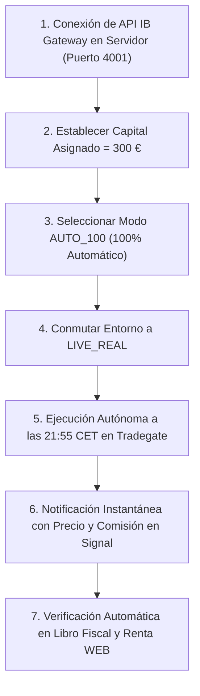

# Aegis-Quant: Protocolo de Transición a Dinero Real (IBKR)
## Checklist Operativo, Modo 100% Automático y Despliegue con 300 € en Producción

> **DOCUMENTO OFICIAL DE PROCEDIMIENTO EN VIVO — SISTEMA AEGIS-QUANT**
> *Destinatario: Operador del Sistema & Inversor Residente en España*
> *Ruta: `docs/TRANSICION_DINERO_REAL_CHECKLIST.md`*
> *Última actualización: 29 de Octubre de 2026*

Este documento consolida el procedimiento exacto paso a paso para cuando decidas pasar de **Paper Trading (`PAPER`)** a **Operativa Real en Interactive Brokers (`LIVE_REAL`)** en **Modo 100% Automático (`AUTO_100`)** y con un capital de prueba de **300 €**.

---

## 1. Por qué 300 € en Modo 100% Automático es la Mejor Elección

### A. Modo 100% Automático (`AUTO_100`): Eliminación de la Latencia Humana
En la **Opción A (Tradegate Exchange)**, el escaneo diario se produce puntualmente a las **`21:55 CET`** (`15:55 Nueva York`), justamente **5 minutos antes del cierre estricto de la bolsa alemana a las `22:00:00 CET`**:
* **El riesgo del Modo Copiloto:** Si el bot te pide confirmación por Signal a las 21:55 y tardas 2 o 3 minutos en ver el móvil, la orden corre el riesgo de no entrar a mercado antes de las 22:00:00.
* **La ventaja del Modo 100% Automático (`AUTO_100`):** El bot evalúa los 6 motores, calcula el dimensionamiento Meta-Kelly y lanza la orden limitada a Tradegate en milisegundos. Acto seguido, te envía a Signal la confirmación instantánea con el precio ejecutado, las comisiones y el saldo restante. **Cero retraso y cero estrés operativo.**

### B. Ventajas de Empezar con 300 € frente a 50 €
Comenzar con **300 €** ofrece una enorme ventaja cuantitativa y operativa frente a 50 €:

| Parámetro | Prueba con 50 € | Prueba con 300 € (Recomendada) |
| :--- | :---: | :---: |
| **Diversificación Simultánea** | Máximo 1 posición (`SPYL` o `CRUD`) | **Multi-posición activa:** Core `SPYL` + Materias Primas (`CRUD`/`SOYB`) o Bitcoin (`BTCE`) |
| **Capacidad de Compra por Activo** | Solo activos de menos de 20 € | Puede adquirir `SPYL` (~14 €), `CRUD` (~9 €), `SOYB` (~18 €), `BTCE` (~45 €) o `4GLD` (~80 €) |
| **Impacto de la Comisión IBKR (1,25 €)** | **~8,9%** del valor de la orden (muy alta fricción) | **~1,2% – 2,0%** (impacto mucho más realista y asumible) |
| **Cortafuegos Diario (*Kill Switch* a -8%)** | Se activa al perder -4,00 € | Se activa automáticamente si la cuenta pierde **-24,00 €** |
| **Máxima Caída Histórica (-15,7% MaxDD)** | Fluctuación máxima de ~7,80 € | **Fluctuación máxima histórica de ~47,00 €** |

> [!NOTE]
> **Riesgo Monetario Real con 300 €:**
> Con 300 €, la máxima caída histórica experimentada por el sistema en 19 años de backtest (incluyendo las crisis de 2008 y 2020) supondría apenas **47 € de variación**. Y si una sesión sufriera un pánico anómalo, el *Kill Switch* detiene todo automáticamente a los **-24 €**. El riesgo está 100% acotado mientras el algoritmo opera con su verdadera lógica multiactivo.

---

## 2. Gestión Dinámica de Capital (Interés Compuesto) vs Límites Fijos

### A. ¿Qué ocurre cuando la cuenta crece de 10.000 € a 12.000 €?
Si depositas 10.000 € y tras un período de ganancias la cuenta alcanza los **12.000 €**:
* **El error de un límite fijo:** Si el bot continuara dimensionando las posiciones rígidamente sobre los 10.000 € iniciales, **los 2.000 € de beneficios acumulados quedarían ociosos como efectivo muerto**. El interés compuesto se detendría por completo.
* **El principio del Interés Compuesto Dinámico:** Para que la "bola de nieve" ruede ladera abajo, el bot calcula las ponderaciones del Meta-Kelly (el 85% de SPY, el 15% de QQQ o el 10% de SOYB) sobre el **Patrimonio Total Vivo (*Total Equity* o *Net Liquidation Value*)** que reporta Interactive Brokers en tiempo real:
  - Al iniciar con 10.000 €: asigna sobre 10.000 €.
  - Cuando la cuenta sube a 12.000 €: asigna sobre **12.000 €** (reinversión automática de las ganancias).
  - Cuando sube a 15.000 € o 20.000 €: asigna sobre **15.000 € o 20.000 €**.

### B. La Mejor Práctica Institucional: Aislar la Cuenta de IBKR
La conclusión del operador es absolutamente impecable:
> **"Si no quiero invertir más dinero, directamente no lo añado a Interactive Brokers."**

Esta es la regla de oro de la gestión cuantitativa:
1. **Cuenta Exclusiva:** Mantener la cuenta de Interactive Brokers dedicada exclusivamente a la operativa de Aegis-Quant.
2. **Control por Depósito:** Si deseas empezar probando con **300 €**, transfieres exactamente 300 €. El bot sabrá que dispone de 300 € y operará sobre el 100% de ese capital.
3. **Escalado Natural:** Si más adelante decides aportar 1.000 € o 5.000 € adicionales, realizas una transferencia bancaria ordinaria a IBKR; en el siguiente escaneo de las `21:55 CET`, el bot detectará el nuevo saldo total y aumentará el tamaño de las órdenes de forma automática.
4. **Para qué sirve el campo `Capital Asignado` en la web:** Es un mecanismo de seguridad opcional pensado únicamente para quien comparte una cuenta general en IBKR (por ejemplo, con 50.000 € en acciones de dividendos a largo plazo) y desea acotar un techo máximo estricto para el bot. Si la cuenta está dedicada, el bot opera sobre el saldo real completo.

---

## 3. Restricciones de Negociación por Múltiplos Enteros (Ej. SOYB a 18 €, SPYL a 14 €) y Conservación de Liquidez

### A. La Realidad de las Bolsas Europeas (Tradegate / Xetra)
En los mercados europeos, y específicamente al negociar en **Tradegate Exchange (`TGATE`)** con órdenes limitadas a través de Interactive Brokers, **NO existe el fraccionamiento de acciones**. Solo se admiten **participaciones enteras** ($1, 2, 3, 4\dots$).

Por este motivo, para un activo como **`SOYB`** (*WisdomTree Agriculture ETC*, ISIN `GB00B15KY211`), que cotiza a aproximadamente **~18,00 € por participación**, **solo se pueden emitir órdenes por múltiplos exactos de 18 €** (18 €, 36 €, 54 €, 72 €, 90 €...).

### B. Cómo Resuelve el Algoritmo la Discretización de Acciones Enteras
El bot maneja esta restricción física del mercado en tres pasos estrictos:

1. **Cálculo Teórico Óptimo:** El Meta-Kelly calcula el importe monetario ideal según la ventaja estadística:
   $$\text{Presupuesto Objetivo} = \text{Peso \%} \times \text{Patrimonio Total en Euros}$$
2. **Función de Suelo (*Floor Function*) para Acciones Enteras:** El bot divide el presupuesto entre la cotización unitaria del ETF y redondea siempre **hacia abajo** al entero más próximo:
   $$\text{Títulos a Comprar} = \left\lfloor \frac{\text{Presupuesto Objetivo (€)}}{\text{Precio Unitario del ETF (€)}} \right\rfloor$$
   $$\text{Inversión Neta Ejecutada} = \text{Títulos a Comprar} \times \text{Precio Unitario}$$
3. **Conservación de Liquidez:** La diferencia sobrante entre el presupuesto teórico y las acciones enteras adquiridas **permanece automáticamente en el saldo de efectivo (*Cash*)** de la cuenta. Jamás se compran acciones de más, jamás se fuerza la inversión y jamás se incurre en apalancamiento no deseado.

### C. Ejemplos Prácticos Numéricos (Cartera de Prueba de 300 €)

#### Caso 1: Asignación a SOYB (~18 € / acción)
* Supongamos que el Motor 4 detecta una ruptura alcista en la Soja y el Meta-Kelly le asigna un **10%** de la cartera.
* Presupuesto teórico: $10\% \times 300 € = \mathbf{30,00 €}$.
* Cotización unitaria de SOYB: **18,00 €**.
* Cálculo del bot: $\lfloor 30,00 / 18,00 \rfloor = \mathbf{1 \text{ acción}}$.
* **Orden enviada a Tradegate:** `BUY LIMIT 1 SOYB @ 18.00 EUR` (Inversión: 18,00 €).
* **Efectivo retenido:** Los **12,00 €** restantes se quedan en la cuenta como efectivo seguro.
* *Si la cuenta creciese a 500 €:* Presupuesto = 50,00 € $\rightarrow \lfloor 50,00 / 18,00 \rfloor = \mathbf{2 \text{ acciones}}$ (36,00 € invertidos y 14,00 € en efectivo).

#### Caso 2: ¿Qué ocurre cuando el presupuesto no llega al precio de 1 acción? (Regla de Mínimo Unitario)
* Supongamos que en la misma cuenta de 300 €, el sistema asignara un **15%** al Oro físico (`4GLD`), que cotiza a **~80,00 € por acción**.
* Presupuesto teórico: $15\% \times 300 € = \mathbf{45,00 €}$.
* Cálculo del bot: $\lfloor 45,00 / 80,00 \rfloor = \mathbf{0 \text{ acciones}}$.
* **Comportamiento del bot:** **No compra nada.** El bot detecta que no alcanza para 1 título completo, cancela la orden sin forzar la compra y conserva el 100% del dinero (45,00 €) en liquidez. Solo cuando el capital de la cuenta o el porcentaje asignado superen los 80,00 €, se emitirá la orden de compra.

### D. Por qué Elegimos ETFs con Precios Unitarios Bajos en la Opción A
Justamente para minimizar este "error de discretización", la arquitectura de Aegis-Quant seleccionó activos en Tradegate con los precios por acción más accesibles del mercado europeo:

| Activo de Referencia | Ticker Elegido en Tradegate | ISIN | Precio Aprox. por Acción | Múltiplos de Compra | Precisión en 300 € |
| :--- | :---: | :---: | :---: | :---: | :---: |
| **TLT (Bonos 20+ USA)** | **`DTLA`** | `IE00BFM6TC58` | **~4,50 €** | Múltiplos de ~4,50 € | Precisión del 1,5% |
| **USO (Petróleo WTI)** | **`CRUD`** | `GB00B15KXV33` | **~9,00 €** | Múltiplos de ~9,00 € | Precisión del 3,0% |
| **SPY Inverso (-1x)** | **`DXS3`** | `LU0322251520` | **~12,00 €** | Múltiplos de ~12,00 € | Precisión del 4,0% |
| **SPY (S&P 500)** | **`SPYL`** *(vs SXR8 a 580€)* | `IE000XZSV718` | **~14,00 €** | Múltiplos de ~14,00 € | Precisión del 4,6% |
| **ZS (Soja Agrícola)** | **`SOYB`** | `GB00B15KY211` | **~18,00 €** | Múltiplos de ~18,00 € | Precisión del 6,0% |
| **BTC (Bitcoin ETP)** | **`BTCE`** | `DE000A27Z304` | **~45,00 €** | Múltiplos de ~45,00 € | Exige >= 45 € asignados |
| **GLD (Oro Físico)** | **`4GLD`** | `DE000A0S9GB0` | **~80,00 €** | Múltiplos de ~80,00 € | Exige >= 80 € asignados |

> [!TIP]
> **Conclusión sobre los múltiplos de 18 €:**
> El sistema está matemáticamente blindado ante las compras discretas: **nunca gastará más del presupuesto asignado, comprará el múltiplo entero máximo posible y el sobrante se preservará automáticamente en efectivo.**

---

## 4. Checklist Pre-Vuelo para la Conexión Real con IBKR

Antes de pulsar el botón de activación real, comprobaremos juntos estos 6 puntos:

- [ ] **1. Cuenta en Interactive Brokers Irlanda (IBIE):** Cuenta verificada con los **300 €** depositados en saldo EUR.
- [ ] **2. Permisos de Negociación en IBKR:**
  - Habilitar: **Acciones / ETFs en Europa (Alemania / Tradegate / Xetra)**.
  - Divisa base de la cuenta: **EUR**.
- [ ] **3. Conector de API Activo en el Servidor Ubuntu:**
  - **IB Gateway** (o TWS en modo API) corriendo en el servidor (o contenedor Docker `ghcr.io/gnzsnz/ib-gateway`).
  - Puerto de conexión: `4001` (puerto estándar de IB Gateway para dinero real).
  - En la configuración de API de IBKR: *"Enable ActiveX and Socket Clients"* marcado y `127.0.0.1` añadido a IPs de confianza.
- [ ] **4. Comprobación del Reloj Linux (Anti-Deriva DST):**
  - Comando: `timedatectl status`
  - Verificar: `System clock synchronized: yes` y `NTP service: active`.
  - El escáner debe dispararse a las **`21:55 CET`** en punto.
- [ ] **5. Alertas de Signal Verificadas:**
  - Realizar una prueba de notificación para confirmar que tu móvil recibe las alertas operativas al segundo.
- [ ] **6. Interruptores de Seguridad Verificados:**
  - Cortafuegos diario fijado en **-8.0%** (-24 €).
  - Riesgo máximo por operación: **2.5%** (~7,50 €).
  - Botón de Pánico (*Cierre Total a Mercado*) operativo en el panel web.

---

## 5. Procedimiento de Activación Paso a Paso

Cuando me des la señal de arranque, seguiremos este flujo:

### Paso 1: Configuración en el Panel Web
1. Abrir el Centro de Mando web (`http://localhost:8085` o IP del servidor).
2. Abrir el modal de **Configuración**.
3. Seleccionar:
   - Proveedor de Bróker: **`IBKR_LIVE`**
   - Modo de Operación: **`AUTO_100`** *(100% Automático · Sin retraso humano)*
   - Capital Asignado: **`300`**
4. Guardar Configuración.

### Paso 2: La Primera Sesión Real (21:55 CET)
1. A las **21:55 CET**, el bot despierta automáticamente:
   - Consulta el régimen macroeconómico VTS (Contango / Backwardation).
   - Evalúa los 6 motores y calcula el rebalanceo Meta-Kelly sobre la base de 300 €.
   - Emite órdenes limitadas a Tradegate (por ejemplo, compra de participaciones de `SPYL` a ~14 €).
2. A las **21:55:10 CET** (apenas 10 segundos después), recibes en tu móvil por Signal:
   > 💼 **ORDEN EJECUTADA EN MERCADO REAL (AEGIS-QUANT)**
   > • Operación: BUY LIMIT 4 SPYL @ 14.15 EUR
   > • Mercado: Tradegate (Alemania)
   > • Importe invertido: 56.60 € | Comisión IBKR: 1.25 €
   > • Efectivo restante: 242.15 € (80.7% cash)
   > • Estado: En cartera bajo supervisión de Stop ATR y Take Profit.

### Paso 3: Verificación en el Módulo Fiscal
1. En la pestaña **5. Fiscalidad España (IRPF)** en la web, al filtrar por **IBKR (Real)**:
   - Se registra el lote FIFO con su ISIN oficial (`IE000XZSV718`) y tipo de cambio oficial del BCE de ese día.
   - Modelo 720: Saldo ~300 € (0,6% del límite de 50.000 €, estado legal **"Exento"**).
   - Renta WEB: 0,00 € tributables (en España las compras no tributan hasta su venta).

---

## 6. Medidas de Emergencia y Respaldo Técnico

* **Botón de Emergencia (Pánico):** Si en cualquier momento deseas cerrar todas las posiciones y volver al 100% en efectivo, pulsas el botón rojo en la pestaña de inicio y el bot enviará órdenes de venta a mercado en segundos.
* **Apagado del Bot:** Si detienes el servicio (`sudo systemctl stop aegis-quant`), el bot no emitirá ninguna orden más; tus 300 € y tus títulos permanecen intactos en la custodia bancaria de Interactive Brokers Irlanda.

---

> [!TIP]
> **Todo listo para cuando tú decidas:**
> Este protocolo está guardado de forma permanente. Cuando tengas los 300 € en Interactive Brokers y desees activar la operativa, solo escríbeme:
> *"Vamos a preparar la conexión real con 300 € en modo automático"*
> y ejecutaremos este checklist punto por punto.
